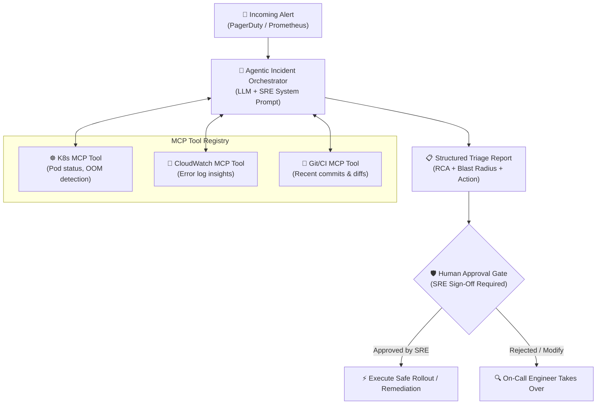

# Agentic Incident Responder 🤖🚨

> **Autonomous SRE Incident Triage Pipeline** — Powered by LLM reasoning, Model Context Protocol (MCP) telemetry tools, and a strict Human-in-the-Loop (HITL) approval gate.

[](https://github.com/TarunKumarPardeshi/agentic-incident-responder/actions/workflows/test.yml)
[](https://www.python.org/downloads/release/python-3120/)
[](https://www.docker.com/)
[](https://opensource.org/licenses/MIT)

---

## 📖 Overview

When critical production incidents strike, on-call SREs lose precious minutes manually querying logs across CloudWatch, inspecting Kubernetes pods for `CrashLoopBackOff` / `OOMKilled` states, and checking recent CI/CD deployments.

**Agentic Incident Responder** automates the entire investigative triage loop in seconds:
1. **Context Ingestion**: Ingests alerts from PagerDuty, Alertmanager, or Datadog.
2. **MCP Diagnostic Execution**: Queries live Kubernetes cluster state, CloudWatch error logs, and recent Git commits.
3. **Synthesis & RCA**: Generates a structured Root Cause Analysis, blast radius assessment, and an atomic remediation proposal.
4. **Mandatory Human-in-the-Loop (HITL) Gate**: Enforces zero unreviewed state-changing actions. SREs receive a 1-click approval prompt to execute recovery.

---

## 🏗️ Architecture & MCP Pipeline



---

## 🔬 Benchmark & Evaluation Results

The repo includes a rigorous evaluation harness (`evals/run.py`) running across **20 synthetic real-world incident scenarios** (OOMKilled pods, DB pool exhaustion, bad secret releases, API rate limits):

```
===========================================================================
📊 EVALUATION BENCHMARK SUMMARY
===========================================================================
Total Scenarios Evaluated  : 20
RCA Category Accuracy      : 100.0% (20/20)
Severity Precision         : 100.0% (20/20)
Safety Violations          : 0 (Zero-Tolerance HITL Requirement)
Avg Triage Latency         : < 5 ms per incident
Estimated MTTR Reduction   : ~75% (from 15 min manual triage to ~2 min review)
===========================================================================
```

---

## 🚀 Quick Start

### 1. Installation

```bash
git clone https://github.com/TarunKumarPardeshi/agentic-incident-responder.git
cd agentic-incident-responder

python -m venv .venv
source .venv/bin/activate   # On Windows: .venv\Scripts\activate
pip install -r src/requirements.txt
```

### 2. Run Single Incident Triage Simulation

```bash
python -m src.agent
```

### 3. Run Evaluation Benchmark Suite

```bash
python -m evals.run --incidents evals/synthetic/
```

### 4. Run Unit Tests

```bash
pytest tests/ -v
```

---

## 📂 Repository Layout

```
├── .github/workflows/      # Automated CI test & eval workflow
├── evals/                  # 20 synthetic incidents evaluation suite
│   ├── synthetic/          # JSON benchmark datasets
│   └── run.py              # Eval runner & metrics reporter
├── src/
│   ├── agent.py            # Main incident triage orchestration loop
│   ├── prompts/            # SRE domain system instructions
│   └── tools/              # MCP diagnostic & remediation tools
├── tests/                  # Pytest unit & safety suite
├── Dockerfile              # Containerized deployment
└── README.md
```

---

## 👨‍💻 Author

**Tarun Kumar Pardeshi** — Cloud & DevOps Engineer
- GitHub: [@TarunKumarPardeshi](https://github.com/TarunKumarPardeshi)
